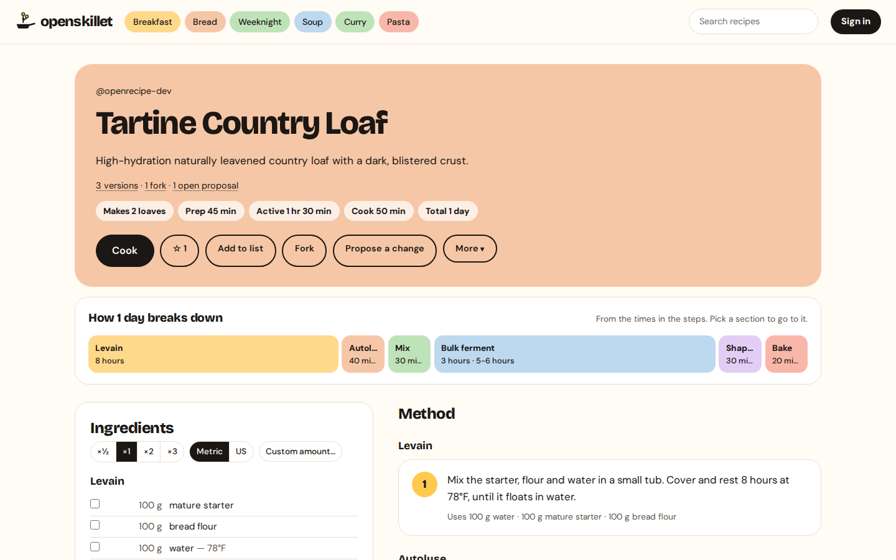
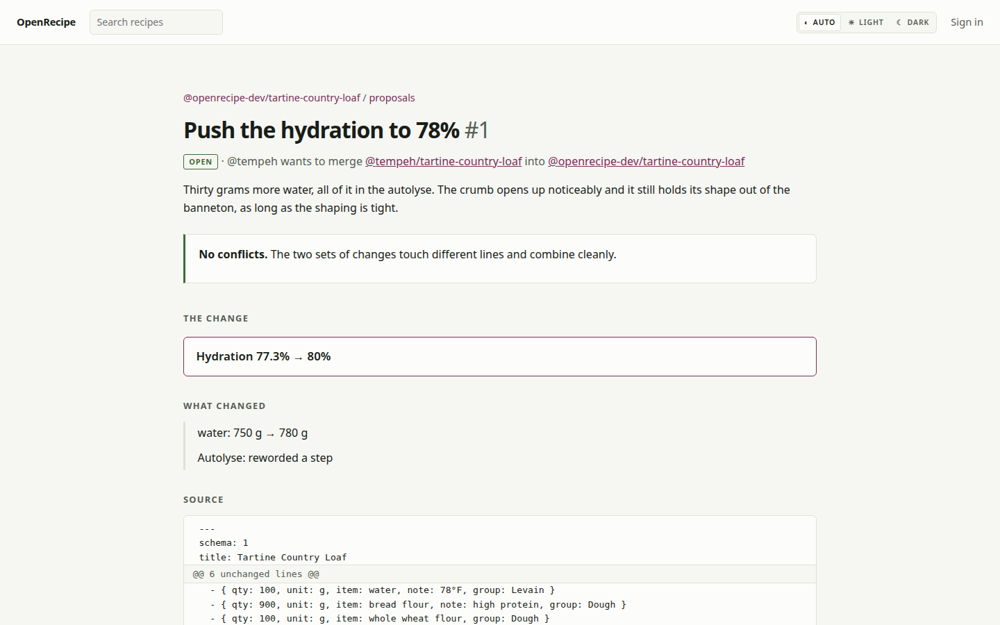
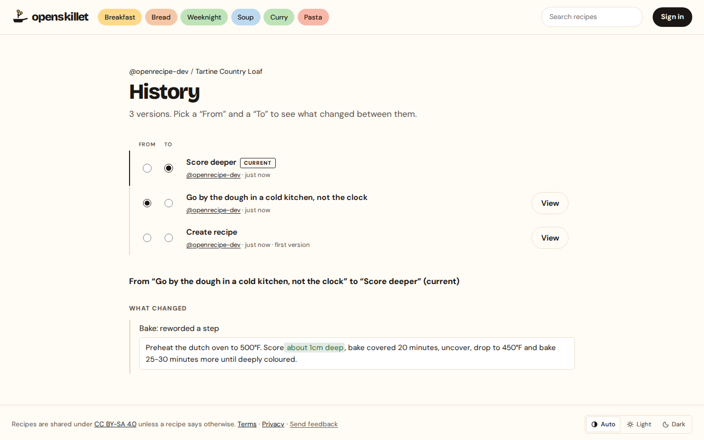
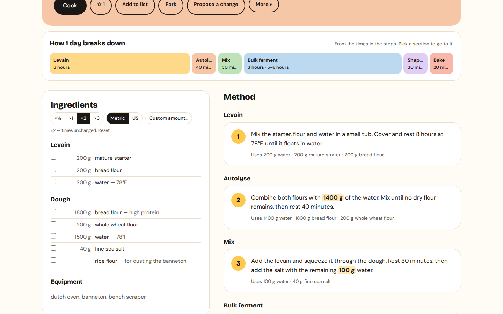
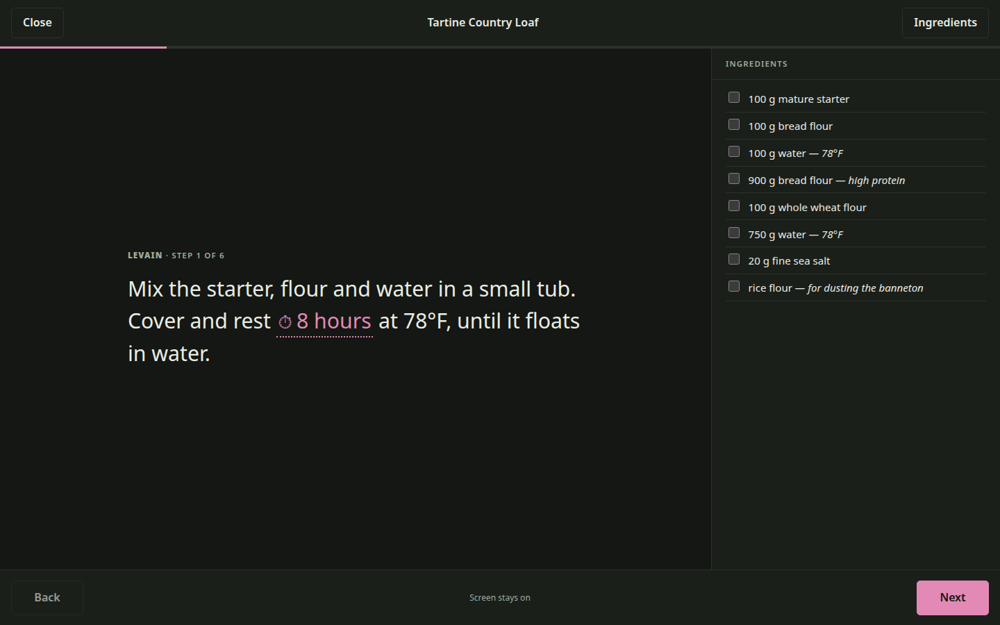
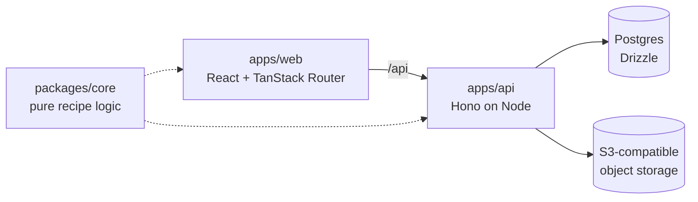

# OpenSkillet

[](https://github.com/dnerever/OpenSkillet/actions/workflows/ci.yml)


[](LICENSE)

Version control for recipes. Fork someone's country loaf, push the hydration up,
and propose the change back — the owner sees a diff in baker's terms, and merges
it with one click.

**Live: [openskillet.com](https://openskillet.com)** · try
[a recipe](https://openskillet.com/openrecipe-dev/tartine-country-loaf),
[an open proposal](https://openskillet.com/openrecipe-dev/tartine-country-loaf/proposals/1),
or [its history](https://openskillet.com/openrecipe-dev/tartine-country-loaf/history).



| A proposal, merging cleanly                     | History, with any two versions compared       |
| ----------------------------------------------- | --------------------------------------------- |
|  |  |

| Scaled ×2 — the amounts in the steps follow the list             | Cook mode, one step at a time                            |
| ---------------------------------------------------------------- | -------------------------------------------------------- |
|  |  |

## What it does

- **Fork and propose.** Any public recipe can be forked into your own namespace,
  changed, and proposed back. The owner merges it, or comments; conflicting
  edits are resolved in the browser.
- **History that reads like cooking.** Every save is a version. Diffs say
  `water: 750 g → 780 g` and `Hydration 77.3% → 80%`, not just which lines moved.
- **Recipes as documents.** Markdown with YAML frontmatter — the same text you
  can download from `/raw` and keep. Ingredients are structured; the method is
  prose. Write one in a form or as the source, a tab apart, and unsaved work
  survives a closed tab.
- **Built for the kitchen.** Scale by yield or by one ingredient, switch metric
  and US units, and amounts written into the steps ("700g of the water") follow
  along. A timeline shows how the time splits across the sections. Cook step by
  step with timers lifted from the text, the screen kept awake, and each step's
  ingredients beside it.
- **Installable, and readable offline.** A web app manifest and a service
  worker: add it to a home screen, and recipes you have opened still load
  without a connection.
- **The rest of a real product.** Private recipes, shared lists with
  collaborators, full-text search, stars, link previews with structured data,
  sign-up confirmed by an emailed code, account settings (email, password,
  sessions), password reset, bot checks and rate limits, reporting and
  moderation, a feedback inbox, and account deletion.

## How it works



A few decisions that carry most of the weight — each is written up in
[docs/ARCHITECTURE.md](docs/ARCHITECTURE.md):

- **The merge engine is pure.** [`packages/core`](packages/core/src) — parse,
  serialize, diff, three-way [merge](packages/core/src/merge.ts), merge-base
  [ancestry](packages/core/src/ancestry.ts), scaling, unit conversion — imports
  no database, network or filesystem, so it is tested exhaustively and shared
  by the API and the browser.
- **Versions are whole-document snapshots with parent pointers**, not a git
  object store. A merge records a second parent, so every later merge base can
  see through it.
- **Authorization lives in one place.** Every read and write of a recipe passes
  through [`services/authorization.ts`](apps/api/src/services/authorization.ts);
  routes never decide. A private recipe answers **404, never 403** — a 403
  would confirm it exists.
- **One container, any host.** Hono serves the built SPA from the same origin as
  the API: no CORS, no cross-site cookies. Migrations run before the server
  binds, and the [`Dockerfile`](Dockerfile) is the only contract with the host.
- **Tests against real infrastructure.** 800+ tests on Node's built-in runner.
  CI runs the API suite against real Postgres and S3-compatible storage, and
  [a guard](apps/api/src/test-guard.ts) refuses to run it against a non-local
  database.

**Stack:** TypeScript · Node 24 · Hono · Drizzle · Postgres · better-auth ·
React 19 · Vite · TanStack Router & Query · CodeMirror 6 · Sentry

---

## Quickstart

Requires **Node 24+** and **Docker**.

```bash
git clone https://github.com/dnerever/OpenSkillet.git && cd OpenSkillet
cp .env.example .env
npm install
npm run db:up        # postgres + rustfs
npm run db:migrate
npm run dev          # core watcher + api :8787 + web :5173
```

Open <http://localhost:5173>. To check the stack,
<http://localhost:5173/api/health> should answer `"status":"ok"` with
`"database":"up"`. A fresh database is empty; `npm run db:seed` (see
[Demo data](#demo-data)) gives it the demo recipes, forks and proposals the
live site links to above.

## Layout

| Path                   | What                                                                                         |
| ---------------------- | -------------------------------------------------------------------------------------------- |
| `packages/core`        | **Pure** recipe-document logic: parse, serialize, hash, diff, merge, scale, convert. No I/O. |
| `apps/api`             | Hono API on Node, Drizzle + Postgres.                                                        |
| `apps/web`             | Vite + React SPA.                                                                            |
| `docs/ARCHITECTURE.md` | Architecture decisions, data model, authorization rules and API surface.                     |
| `docs/DEPLOY.md`       | Deploying: one Docker service on Render, Postgres on Neon.                                   |

`packages/core` compiles to `dist/` and both apps import the built output —
Node's TypeScript type-stripping skips `node_modules`, and workspace packages
resolve through symlinks there. `npm run dev` keeps `tsc -b --watch` running so
`dist/` stays fresh.

## Scripts

| Command                     | Does                                                  |
| --------------------------- | ----------------------------------------------------- |
| `npm run dev`               | core watcher + api + web, together                    |
| `npm run build`             | typecheck and build everything                        |
| `npm test`                  | `node --test` across core, api and web                |
| `npm run test:e2e`          | Playwright flows against the built app — see below    |
| `npm run lint`              | ESLint, type-aware                                    |
| `npm run db:up` / `db:down` | Postgres + RustFS via Docker Compose                  |
| `npm run db:generate`       | generate a migration from `apps/api/src/db/schema.ts` |
| `npm run db:migrate`        | apply pending migrations                              |
| `npm run db:studio`         | Drizzle Studio                                        |
| `npm run db:seed`           | Demo cooks, recipes, forks and proposals — see below  |
| `npm run import:notion`     | Load a Notion recipe export — see below               |
| `npm run import:urls`       | Fetch the recipe pages the Notion import bookmarked   |
| `npm run format`            | Prettier                                              |

Local services: Postgres on `:5432`, RustFS on `:9000` (console `:9001`,
user/password `openrecipe` / `openrecipe-dev-secret`). These local identifiers
remain stable so existing Docker volumes and RustFS data keep working. Image
uploads need
`S3_ENDPOINT`, `S3_BUCKET`, `S3_ACCESS_KEY` and `S3_SECRET_KEY` (`S3_REGION` is
optional, defaulting to `auto`); without them everything else works and uploads
answer 503.

Everything else is optional, and documented in [`.env.example`](.env.example):

| Variable                                     | Without it                                                                                   |
| -------------------------------------------- | -------------------------------------------------------------------------------------------- |
| `RESEND_API_KEY`, `MAIL_FROM`                | Sign-up codes, password-reset links and email-change links are printed to the API's console. |
| `TURNSTILE_SITE_KEY`, `TURNSTILE_SECRET_KEY` | No bot check on sign-up, sign-in and password reset. `TURNSTILE_ENABLED=false` turns it off. |
| `ADMIN_EMAILS`                               | Nobody is an admin; `/admin` (reports and feedback) is a 404 for everyone.                   |
| `CLIENT_IP_HEADER`                           | Rate limits key on `x-forwarded-for`. Behind Cloudflare's proxy, use `cf-connecting-ip`.     |
| `GITHUB_CLIENT_ID`, `GITHUB_CLIENT_SECRET`   | No GitHub sign-in — see [Sign-in](#sign-in).                                                 |

## End-to-end tests

`npm run test:e2e` drives the three flows `docs/ARCHITECTURE.md` §6 names in a real
browser, against the production build served the way the container serves it.
Build and migrate first; on a machine with Chrome but no Playwright browsers,
point it at Chrome:

```bash
npm run build && npm run db:migrate
PLAYWRIGHT_CHANNEL=chrome npm run test:e2e
```

## Demo data

`npm run db:seed` fills a database with something to look at: two cooks, a dozen
recipes from core's fixture corpus, a few versions of history, three forks, one
merged proposal and one still open, a public list, and some stars.

```bash
npm run db:seed -- --owner alice --contributor bob --dry-run
npm run db:seed -- --owner alice --contributor bob
```

Locally, handles that do not exist yet are created and can sign in with the
password the script prints. Against any other database both accounts must
already exist, and it refuses to write without `--yes`, the same as the
importers below. Re-running is safe: anything already there is left alone.

The scenario itself is data, in `apps/api/src/seed/scenario.ts`. A dry run
replays it in memory first, every edit and every merge, so a fixture that
drifts fails the dry run (and `scenario.test.ts`) instead of a real one.

## Importing from Notion

`npm run import:notion` reads a Notion database export (the folder of `.md`
files) and loads it as recipes. Notion rows come in two kinds and it treats them
differently: a page with real content becomes a recipe, and a page that is only
a saved link becomes a line in `import-data/notion-bookmarks.json` — gitignored,
and shaped for a later pass that fetches those URLs. A page holding nothing but
a photo counts as a bookmark too, because the attachment cannot come across.

```bash
npm run import:notion -- --dir "path/to/export/Recipes" --owner your-handle --dry-run
```

`--complete-only` narrows it to pages carrying both an ingredient list and a
method — a recipe somebody could cook from. Most Notion pages have one or the
other, so this is usually the flag you want.

Drop `--dry-run` to write. It defaults to `--visibility private`, is safe to
re-run (a slug that already exists under that owner is skipped), and never
invents a quantity — an ingredient line it cannot read is kept whole as
`{ qty: null, item: <the line> }` for you to fix in the editor.

To load a deployed database, pass the connection string in the environment
rather than putting it in `.env` — see [docs/DEPLOY.md](docs/DEPLOY.md) for why.
A shell variable wins over `--env-file`, so this overrides the local `.env` the
script would otherwise read:

```bash
read -rs -p "DATABASE_URL: " DATABASE_URL && export DATABASE_URL
npm run import:notion -- --dir "…" --owner your-handle --complete-only --dry-run
npm run import:notion -- --dir "…" --owner your-handle --complete-only --yes
unset DATABASE_URL
```

The script prints the target host before writing and **refuses a non-local
database unless you pass `--yes`**, on the same reasoning as
`apps/api/src/test-guard.ts`: an import that lands in the wrong database looks
exactly like one that worked. Only the host is ever printed, never the
credential.

## Importing from recipe sites

`npm run import:urls` finishes what the Notion import starts. It reads
`import-data/notion-bookmarks.json`, fetches each page, and turns the
`schema.org/Recipe` JSON-LD in it into a recipe — the standard nearly every
recipe site publishes, so there is no per-site code. Start with one site:

```bash
npm run import:urls -- --domain itdoesnttastelikechicken.com --dry-run
npm run import:urls -- --domain itdoesnttastelikechicken.com --owner your-handle --yes
```

`--url` takes a single page instead of the bookmark file, and can be repeated.
A dry run fetches and converts everything and writes nothing, so what it prints
is exactly what a real run will create.

It keeps the name you saved each bookmark under rather than the page's SEO
title, merges the bookmark's tags with the site's, and records the page as the
recipe's `source` along with the author's byline. Like the Notion import it
defaults to `--visibility private` — these are other people's published
recipes — skips a slug that already exists, and never invents a quantity. A page
with no recipe data, or a roundup with no single method to import, is reported
and skipped. It fetches one page at a time, 1.5 seconds apart (`--delay`), under
a user agent that says what it is.

## Sign-in

Email and password work out of the box. In production a new email account is
confirmed with a six-digit code sent to the address before it can set a
password; locally, without `RESEND_API_KEY`, the code is printed to the API's
console instead. `/login`, `/signup` and the other addresses people type out of
habit redirect to `/signin`.

GitHub sign-in is **only registered when both `GITHUB_CLIENT_ID` and
`GITHUB_CLIENT_SECRET` are set**, so a fresh clone runs without anyone creating
an OAuth app. When you do want it, the callback URL is
`http://localhost:5173/api/auth/callback/github`.

Handles are claimed at signup: supply one, or we derive it from your email and
suffix `-2`, `-3`, … on collision. Anything that could become a top-level route
(`settings`, `search`, `raw`, …) is reserved — see
`apps/api/src/services/handles.ts`.

## URLs

| Path                               | What                                        |
| ---------------------------------- | ------------------------------------------- |
| `/{handle}`                        | A cook's recipes, stars and lists           |
| `/{handle}/{slug}`                 | A recipe                                    |
| `/{handle}/{slug}/cook`            | Cook mode — one step at a time              |
| `/{handle}/{slug}/history`         | Every version, and any two compared         |
| `/{handle}/{slug}/forks`           | Its forks, with what each one changed       |
| `/{handle}/{slug}/proposals`       | Proposals against this recipe               |
| `/{handle}/lists/{list}`           | A list of recipes                           |
| `/search`                          | Full-text search, filtered by tag           |
| `/new`                             | Write a recipe                              |
| `/settings`                        | Email, password, sessions, account deletion |
| `/admin`                           | Reports and feedback, for `ADMIN_EMAILS`    |
| `/api/recipes/{handle}/{slug}/raw` | The recipe as portable Markdown             |

`?scale=` and `?units=metric|us` on a recipe are a _view_ of it: they scale and
convert what you are reading, mint no version, and are inherited by cook mode.
Leave them off and you get exactly what the author wrote: the units control
starts on whichever system the recipe was written in, which `detectSystem` reads
off its own ingredients.

Handles sit at the top level, which is why the API reserves every word that
could become a route.

## Conventions

- **`packages/core` stays pure.** No database, network, or filesystem imports.
  The merge engine's testability depends on it.
- **Relative imports carry `.ts` extensions.** Node runs the TypeScript directly;
  `tsc` rewrites the extension on emit.
- **Authorization lives in services, not routes** — see `docs/ARCHITECTURE.md` §5.1.
  `canRead` / `canWrite` live in `apps/api/src/services/authorization.ts`; a
  route that could return a recipe without passing through them is a bug.
- **Everything the browser calls is under `/api`, and the dev proxy forwards
  that prefix rather than stripping it.** better-auth derives OAuth callback
  URLs from the browser-visible path, so the two must be identical.
- **Private recipes 404, never 403.** A 403 confirms the recipe exists.
